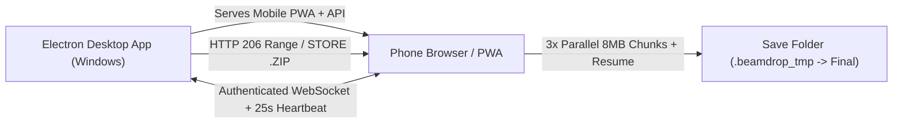

<h1 align="center">BeamDrop</h1>
<p align="center"><b>Your videos and files, straight across the room.</b><br>A free, open-source, zero-cloud wireless file &amp; 2GB+ video transfer app for Windows PC and Mobile (iOS &amp; Android).</p>

<p align="center">
  <a href="https://github.com/p4inz-code/beamdrop/releases/latest"></a>
  <a href="https://github.com/p4inz-code/beamdrop/actions/workflows/ci.yml"></a>
  <a href="https://github.com/p4inz-code/beamdrop/stargazers"></a>
  <a href="LICENSE"></a>
  <a href="https://discord.gg/8UKt8s5FbW"></a>
</p>

---

You have a 1.5 GB video on your PC and want it on your phone right now—without uploading it to Google Drive, emailing yourself links, hunting for a USB cable, or installing sketchy ad-filled apps on your phone.

**BeamDrop** turns your PC into a hardened local transfer hub over your Wi-Fi or Windows Mobile Hotspot. Scan a QR code with your phone camera, tap **Allow** on your PC, and stream or download original-quality 2GB+ videos at full LAN speed. No account, no cloud, no telemetry.

> **Status: v1.2.0, audited (30/30) and ready for daily 1GB–2GB+ video transfers on Windows (cross-platform CI builds for macOS & Linux).**
> See [Audit Report](AUDIT_REPORT.md), [Known Issues](docs/KNOWN_ISSUES.md), and the [Roadmap](ROADMAP.md).

---

## Screenshots

<table>
<tr>
<td width="68%" align="center">
<sub>Desktop App (Custom Frameless UI · Electron)</sub><br><br>

</td>
<td width="32%" align="center">
<sub>Mobile Web / PWA (Thumb-First UI)</sub><br><br>

</td>
</tr>
</table>

---

## What BeamDrop Does

- **2GB+ Chunked Resumable Uploads (Phone → PC)**: Splits large files into 8 MB slices and uploads with **3x parallel workers**, automatic chunk retry, fingerprint-based resume across disconnects, Wake Lock screen protection, and `statfs` disk-space pre-checks. Memory usage stays flat (~40 MB).
- **Instant Video Streaming (`HTTP 206 Partial Content`)**: Scrub and play 1GB–2GB+ MP4, MOV, and WebM videos directly in your phone's browser without waiting for a full download—or tap **Download** for raw full-speed transfer.
- **Zero-CPU Streaming `.ZIP`**: Select multiple files or drop an entire folder on PC and download it as a single `.zip` streamed on the fly in `STORE` mode (`level: 0`) so your PC stays cool.
- **Versatile, Hardened Pairing**:
  - **QR Code (`Level Q`)** with a rotating 128-bit `qrSecret` for 1-scan pairing.
  - **Instant Connect Link** one-click copy button.
  - **4-Digit PIN** with per-IP rate limiting (`PinRateLimiter`: 5 attempts $\rightarrow$ 120s lockout) and constant-time verification (`crypto.timingSafeEqual`).
  - **Explicit PC `[Allow / Block]` Prompt** + individual device **Kick** and **Revoke All**.
- **Two-Way Live Clipboard**: Push links and snippets between PC and Phone over authenticated WebSockets (with HTTP legacy copy fallback for non-HTTPS LAN origins).
- **Custom Frameless Window**: Zero native OS title bar or OS form controls, System Tray minimize, and strict Electron sandboxing (`contextIsolation: true`, `nodeIntegration: false`, `sandbox: true`).

---

## Architecture



---

## Quick Start

### Option 1: Download Prebuilt Installer (Recommended)
Grab the latest installer for **Windows**, **macOS**, or **Linux** from [GitHub Releases](https://github.com/p4inz-code/beamdrop/releases/latest) — no Node.js required.

### Option 2: Run From Source
- **Node.js v20+** (tested on Node.js v24)
- PC and Phone on the **same Wi-Fi network** or **Windows Mobile Hotspot**

```bash
git clone https://github.com/p4inz-code/beamdrop.git
cd beamdrop
npm install
npm start
```

### Transfer Videos in 3 Steps
1. **Drop** videos, files, or folders into the BeamDrop PC window.
2. **Scan the QR Code** on your phone (or use **Copy Instant Connect Link** / enter the URL + 4-digit PIN).
3. Click **Allow** on the PC banner, then tap **Stream Video**, **Preview**, **Download**, or **Download .ZIP** on your phone.

> **Windows Firewall Note**: On first launch, allow **Private networks** in Windows Defender Firewall so your phone can reach port `5050`. If you turn on a Mobile Hotspot after launching, click the **Refresh Network Adapters** button in the sidebar.

---

## Verification & Testing

```bash
npm test
```

The automated `node --test` suite verifies:
- Path traversal, null-byte, and Windows reserved-name sanitization (`sanitizeFilename`, `resolveSafePath`)
- PIN brute-force rate limiting & lockout (`429 Retry-After`)
- QR secret pairing, PC approval flow, and individual device `Kick`
- 3-worker parallel out-of-order chunked uploads with byte-for-byte **SHA-256** integrity
- Fingerprint-based upload resume (`resumed: true`)
- `HTTP 206` byte-range streaming & `416` bounds handling
- Streaming `.zip` generation (`PK\x03\x04`, `PK\x05\x06`, intact `STORE` payload)
- Cross-origin CSRF blocking (`403`) & `EADDRINUSE` port fallback

---

## Project Docs

- [Changelog](CHANGELOG.md) — Release history (`v1.2.0`, `v1.0.0`)
- [Audit Report](AUDIT_REPORT.md) — 5-round quality & security audit (`30 / 30`)
- [Privacy Policy](PRIVACY.md) — Zero-telemetry & local-only data guarantee
- [Roadmap](ROADMAP.md) — Upcoming `v1.3.0` & `v2.0.0` milestones
- [Known Issues](docs/KNOWN_ISSUES.md) — Current platform & network caveats
- [Security Policy](SECURITY.md) — Threat model & vulnerability reporting
- [Contributing](CONTRIBUTING.md) — Dev setup & engineering standards
- [Code of Conduct](CODE_OF_CONDUCT.md) — Community guidelines

---

## Copyright & License

**Copyright (C) 2026 Atharva Patil (`p4inz-code`). All rights reserved.**
Built by **[Atharva Patil | P4inz](https://github.com/p4inz-code)** — *Open-source software, creative tools & experimental technology.*

Licensed under the **GNU General Public License v3.0 (GPL-3.0-or-later)**. See [LICENSE](LICENSE) and [NOTICE](NOTICE) for details.
