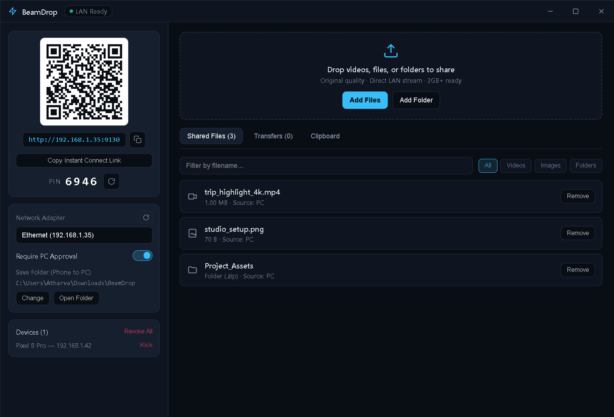
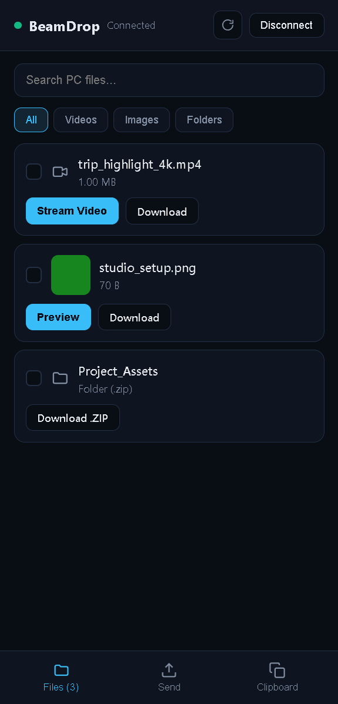

# BeamDrop

**Zero-cloud, high-throughput local Wi-Fi file & 2GB+ video transfer app for Windows PC and Mobile (iOS & Android).**

Built by **[Atharva Patil | P4inz (`p4inz-code`)](https://github.com/p4inz-code)** — *Open-source software, creative tools & experimental technology.*

---

## Screenshots

| Desktop App (Custom Frameless UI) | Mobile Web / PWA (Thumb-First UI) |
| :---: | :---: |
|  |  |

---

## Why BeamDrop?

- **Zero-Install Phone Client**: Works directly in Safari or Chrome on iOS and Android (installable as a PWA)—no app store downloads required.
- **2GB+ Video & File Engine**:
  - **PC → Phone**: Full `HTTP 206 Partial Content` byte-range streaming to scrub and play 1GB–2GB+ MP4/MOV/WebM videos directly, or download at full LAN speed.
  - **Phone → PC**: **3x parallel 8 MB chunked uploads** with automatic retry, pause/resume, fingerprint-based resume across disconnects, Wake Lock screen protection, and `statfs` disk-space pre-checks.
  - **Zero-CPU Streaming ZIP**: Download folders or multi-file batches as `.zip` using `STORE` mode (`level: 0`) so your PC stays cool and transfers at full Wi-Fi bandwidth.
- **Versatile & Hardened Pairing**:
  - **QR Code (`Level Q` error correction)** with a rotating 128-bit `qrSecret` for 1-scan pairing.
  - **Instant Connect Link** one-click copy button on PC.
  - **4-Digit PIN** with per-IP rate limiting & lockout (`PinRateLimiter`) + constant-time verification (`crypto.timingSafeEqual`).
  - **Explicit PC `[Allow / Block]` Approval** + individual device **Kick** and **Revoke All**.
- **Security-First Architecture**:
  - Electron runs with `contextIsolation: true`, `nodeIntegration: false`, `sandbox: true`, custom frameless window chrome, and strict CSP.
  - Strict path sanitization (`sanitizeFilename`, `resolveSafePath`) prevents `../` traversal and Windows reserved-name (`CON`, `NUL`, etc.) exploits.
  - Zero `innerHTML` usage on untrusted data (XSS-safe DOM rendering) + `Origin` CSRF validation + authenticated WebSockets with 25s heartbeat.

---

## Architecture


---

## Quick Start (For Anyone)

### Prerequisites
- **Node.js v20+** (tested on Node.js v24)
- PC and Phone on the **same Wi-Fi network** or **Windows Mobile Hotspot**

### Run Locally
```bash
git clone https://github.com/p4inz-code/beamdrop.git
cd beamdrop
npm install
npm start
```

### Transfer Videos in 3 Steps
1. **Drop** your videos, files, or folders into the BeamDrop PC window.
2. **Scan the QR Code** with your phone camera (or click **Copy Instant Connect Link** / enter the URL + 4-digit PIN).
3. Click **Allow** on the PC banner, then tap **Stream Video**, **Preview**, **Download**, or **Download .ZIP** on your phone.

> **Windows Firewall Tip**: On first launch, allow **Private networks** in Windows Defender Firewall so your phone can reach the local server. If you enable a Mobile Hotspot after launching, click the **Refresh Network Adapters** button in the sidebar.

---

## Verification & Testing

```bash
npm test
```

The automated test suite (`node --test`) verifies:
- Path traversal & Windows reserved filename sanitization
- PIN brute-force rate limiting & lockout
- QR secret pairing, PC approval flow, and individual device kick
- 3-worker parallel out-of-order chunked uploads with SHA-256 integrity
- Fingerprint-based upload resume
- `HTTP 206` byte-range video streaming & `416` bounds handling
- Streaming `.zip` generation (`PK\x03\x04` & `PK\x05\x06` verification)
- Cross-origin CSRF blocking (`403`) & `EADDRINUSE` port fallback

---

## Roadmap (Next Version)

- **v1.1 — Discovery & Packaging**:
  - mDNS (`beamdrop.local`) zero-IP discovery on LAN
  - Signed Windows `.exe` / NSIS installer via `electron-builder`
  - Optional local HTTPS (self-signed cert) for native `navigator.clipboard` & PWA install prompts
- **v2.0 — Pro Media & Multi-Peer**:
  - Hardware-accelerated optional video transcode profile (for HEVC/MKV compatibility on older phones)
  - Multi-phone room broadcast & folder two-way sync

---

## Copyright & License

**Copyright (C) 2026 Atharva Patil (`p4inz-code`). All rights reserved.**

This program is free software: you can redistribute it and/or modify it under the terms of the **GNU General Public License v3.0 (GPL-3.0-or-later)** as published by the Free Software Foundation. See [LICENSE](LICENSE) for the full license text.
